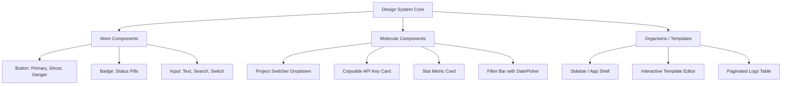

# 10. Frontend UI/UX Design System & Specification

> **Version:** 1.0  
> **Product:** NotifyHub (Transactional Email Notification SaaS)  
> **Target Audience:** Developers (Tenants) & Platform Admins  
> **Design Philosophy:** Minimalist, Developer-first, Modern Dark/Light SaaS aesthetic (inspired by Vercel, Resend, and Linear).

---

## 1. Design System & Visual Tokens

### 1.1 Color Palette

NotifyHub uses a clean monochromatic base with high-contrast functional accents (Emerald for Success, Crimson for Failed/Danger, Indigo/Violet for Brand).

#### Neutral Shades (Base Surfaces & Text)
| Token | Light Theme | Dark Theme | Usage |
|---|---|---|---|
| `bg-primary` | `#F8FAFC` (Slate 50) | `#0B0F19` (Deep Slate) | Main page background |
| `bg-surface` | `#FFFFFF` (Pure White) | `#111827` (Gray 900) | Cards, Modals, Dropdowns |
| `bg-elevated` | `#F1F5F9` (Slate 100) | `#1F2937` (Gray 800) | Table headers, Hover states |
| `border-subtle` | `#E2E8F0` (Slate 200) | `#1F2937` (Gray 800) | Dividers, Card borders |
| `border-strong` | `#CBD5E1` (Slate 300) | `#374151` (Gray 700) | Input borders, Active borders |
| `text-primary` | `#0F172A` (Slate 900) | `#F9FAFB` (Gray 50) | Headings, Primary labels |
| `text-secondary` | `#475569` (Slate 600) | `#9CA3AF` (Gray 400) | Descriptions, Sub-labels |
| `text-muted` | `#94A3B8` (Slate 400) | `#6B7280` (Gray 500) | Placeholders, Timestamps |

#### Functional & Semantic Colors
| State | Light Theme | Dark Theme | Badge Text / Fill |
|---|---|---|---|
| **Brand / Accent** | `#6366F1` (Indigo 500) | `#818CF8` (Indigo 400) | Primary actions, Active links |
| **Success (`sent`, `active`)** | `#10B981` (Emerald 500) | `#34D399` (Emerald 400) | Soft green bg (`#ECFDF5` / `#064E3B`) |
| **Danger (`failed`, `blocked`)** | `#EF4444` (Red 500) | `#F87171` (Red 400) | Soft red bg (`#FEF2F2` / `#7F1D1D`) |
| **Warning (`draft`, `inactive`)**| `#F59E0B` (Amber 500) | `#FBBF24` (Amber 400) | Soft amber bg (`#FFFBEB` / `#78350F`) |
| **Archive (`archived`)** | `#6B7280` (Gray 500) | `#9CA3AF` (Gray 400) | Neutral gray badge |

---

### 1.2 Typography
- **Primary Font Family:** `Inter`, `-apple-system`, `BlinkMacSystemFont`, `Segoe UI`, `sans-serif`
- **Monospace Font (Code & API Keys):** `JetBrains Mono`, `Fira Code`, `ui-monospace`, `monospace`
- **Scale:**
  - `Display / Hero`: 32px (`text-3xl`), `font-bold`
  - `Page Title`: 24px (`text-2xl`), `font-semibold`
  - `Section / Card Title`: 18px (`text-lg`), `font-medium`
  - `Body / Normal`: 14px (`text-sm`), `font-normal`
  - `Caption / Meta`: 12px (`text-xs`), `font-medium`

---

### 1.3 Theme Toggle Architecture
- **Strategy:** Tailwind CSS `class` strategy (`<html class="dark">`).
- **States:** `light`, `dark`, or `system` (matches OS preference).
- **Persistence:** Saved in `localStorage.getItem('theme')`.
- **Toggle Control:** Sun/Moon icon button with smooth transition in top navigation bar.

---

## 2. Core Reusable Component Library



### 2.1 Buttons (`<Button />`)
- **Primary:** Solid Indigo/Brand, white text, subtle shadow, active scale down.
- **Secondary:** Surface background with strong border, neutral text.
- **Outline / Ghost:** Transparent background, visible on hover.
- **Danger:** Soft red background with dark red text, or solid red for critical actions.
- **Icon Button:** Square/Circular padded button for theme toggle, copy, close, refresh.
- **Loading State:** Automatically disables button and displays a spinning SVG icon.

### 2.2 Badges & Status Pills (`<Badge />`)
Pill-shaped indicator (`rounded-full px-2.5 py-0.5 text-xs font-medium`):
- `Active` 🟢 Green dot + "Active"
- `Inactive` ⚪ Gray dot + "Inactive"
- `Sent` 🟢 "Sent"
- `Failed` 🔴 "Failed"
- `Draft` 🟡 "Draft"
- `Archived` 📁 "Archived"
- `Admin` 🛡️ Violet badge
- `Developer` 💻 Slate badge

### 2.3 Form Elements
- **Input Fields:** Rounded-lg, subtle border, focus ring with Indigo brand color.
- **Search Bar:** Input with left magnifying glass icon and clear `x` button.
- **Dropdowns / Select:** Custom styled popover menu with keyboard navigation.
- **Toggle Switch:** iOS-style pill toggle for instant status toggle (Active/Inactive).

### 2.4 Modals & Drawers (`<Modal />`, `<Drawer />`)
- Backdrop blur (`backdrop-blur-sm bg-black/50`).
- Slide-in and fade animation.
- Close on `Escape` key or backdrop click.
- Fixed header, scrollable body, sticky action footer.

### 2.5 Toast Notifications (`<Toast />`)
- Position: Top-right or Bottom-right.
- Variants: Success (Green), Error (Red), Warning (Amber), Info (Blue).
- Auto-dismiss after 4 seconds with manual dismiss cross icon.

### 2.6 Skeletons & Empty States
- **Skeleton Loaders:** Shimmering animated gray placeholders while data loads.
- **Empty State Card:** Clean SVG illustration, title, friendly subtitle, and a primary Call-To-Action button (e.g., *"No projects yet. Create your first project to start sending emails!"*).

---

## 3. App Shell & Layout Structure

The app shell wraps all authenticated pages in a unified, modern dashboard layout.

```text
+----------------------------------------------------------------------------------+
|  NotifyHub [Logo]   |   [ Project: My E-commerce App ▼ ]   |  [Theme]  [User Profile]|
+---------------------+--------------------------------------+---------------------+
|  SIDEBAR            |  MAIN CONTENT AREA                                         |
|                     |                                                            |
|  📊 Analytics       |  +-------------------------------------------------------+ |
|  📁 Projects        |  |  Page Header (Title, Subtitle, Action Buttons)        | |
|  📑 Templates       |  +-------------------------------------------------------+ |
|  📜 Email Logs      |                                                            |
|  -----------------  |  +-------------------+ +-------------------+ +---------+ | |
|  🛡️ Admin Panel     |  | Metric Card 1     | | Metric Card 2     | | Card 3  | | |
|  (Only if admin)    |  +-------------------+ +-------------------+ +---------+ | |
|                     |                                                            |
|                     |  +-------------------------------------------------------+ |
|                     |  | Main Data Views (Charts, Tables, Editors)             | |
|                     |  +-------------------------------------------------------+ |
+---------------------+------------------------------------------------------------+
```

### 3.1 Top Navigation Bar
1. **Left:** NotifyHub Brand Logo & Text.
2. **Project Switcher (Central / Left):** 
   - A dropdown showing the currently active project name.
   - Click to reveal list of user projects + *"Create New Project"* shortcut.
   - Selecting a project immediately updates global application context and refreshes project-scoped data.
3. **Right:**
   - **Theme Toggle Button** (Sun / Moon).
   - **User Menu:** Avatar with initials, user name, role badge, and dropdown containing:
     - Profile Info (Email, Role: Developer / Admin)
     - Log Out button (Calls `POST /api/v1/auth/logout` and clears cookie).

### 3.2 Sidebar Navigation
- **Dashboard / Analytics:** `/dashboard` (Icon: `LayoutDashboard`)
- **Projects:** `/projects` (Icon: `FolderKanban`)
- **Templates:** `/templates` (Icon: `FileCode2`)
- **Email Logs:** `/logs` (Icon: `History`)
- *Divider*
- **Admin Panel** (Visible only if `user.role === 'admin'`):
  - **Overview:** `/admin` (Icon: `ShieldCheck`)
  - **Users:** `/admin/users` (Icon: `Users`)
  - **All Projects:** `/admin/projects` (Icon: `FolderGit2`)

---

## 4. Screen-by-Screen Detailed Specifications

### Screen 1: Authentication (Login & Signup)
- **Path:** `/login` and `/signup`
- **Layout:** Centered split-card or clean minimalist card on subtle dotted background.
- **Elements:**
  - App Logo & welcoming headline.
  - Inputs: Name (Signup only), Email, Password (with toggle eye icon to show/hide).
  - Primary button: *"Sign In"* / *"Create Developer Account"*.
  - Link to switch between Login and Signup.
  - Client-side validation: Valid email format, min 8-character password.
  - Error alert banner for invalid credentials or blocked accounts.

---

### Screen 2: Project Management (`/projects`)
- **Purpose:** View, manage, create, and configure API keys for projects.
- **Elements:**
  - **Header:** "Projects" heading + *"New Project"* button.
  - **Project Grid / Cards:**
    - Project Name & Description.
    - Status Badge (`active` / `inactive`) with inline toggle switch.
    - Quick Metrics: Total templates count, Created date.
    - Actions Dropdown: Regenerate API Key, Edit Details, Delete Project.
  - **Modal 1: Create Project Modal:**
    - Fields: Project Name, Description.
    - Action: Submit calls `POST /api/v1/projects`.
  - **Modal 2: One-Time API Key Display Modal (Critical Security UX):**
    - Opens immediately upon project creation or key regeneration.
    - Large Monospace Key Box with a one-click *"Copy Key"* button.
    - Warning banner: *"Save this key securely now. For your security, this key will never be displayed again."*
    - Checkbox: *"I have safely stored my API key"* before dismissing modal.

---

### Screen 3: Email Templates (`/templates`)
- **Purpose:** Manage templates under the currently selected project.
- **Elements:**
  - **Header:** "Templates" + *"Create Template"* button.
  - **Template List Cards / Table:**
    - Name (e.g., `welcome-email`, `password-reset`).
    - Subject Line.
    - Category Badge (`authentication`, `marketing`, etc.).
    - Status Pill (`draft`, `active`, `archived`) with quick status change menu.
    - Variables detected tag list (e.g., `{{name}}`, `{{otp}}`).
  - **Create / Edit Template Studio (Split Pane View):**
    - **Left Pane (Editor):**
      - Name, Subject, Category.
      - HTML Source Editor (with syntax highlighting or monospace textarea).
      - Detected Variables preview list (automatically updates as user types `{{variable}}`).
    - **Right Pane (Live Preview):**
      - Interactive simulated email client container.
      - Dynamic variable input fields to test live substitution with mock values.
      - Instant preview render showing how the email will look to recipients.

---

### Screen 4: Email Logs & Real-Time Audit (`/logs`)
- **Purpose:** Inspect transactional email delivery attempts, monitor failures, and debug payloads.
- **Elements:**
  - **Filters Toolbar:**
    - Search input: Filter by recipient email (`to`).
    - Status Filter Dropdown: `All Statuses`, `Sent`, `Failed`.
    - Date Range Filter: Start date and End date pickers.
    - Scope Toggle: *"Current Project"* vs *"All My Projects"*.
    - Reset Filters button.
  - **Logs Data Table:**
    - Columns:
      1. Recipient (`to`)
      2. Template Name (with snapshot badge)
      3. Subject
      4. Status (`Sent` in Emerald badge / `Failed` in Red badge)
      5. Sent Timestamp (`relative` like "5 mins ago" with exact hover tooltip)
      6. Details action button (eye icon)
  - **Log Details Drawer / Modal:**
    - Displays full log details: Log ID, Project ID, Template Snapshot Name, Recipient.
    - If `status === 'failed'`: Prominent red error alert box with safe error message reason.
    - Raw metadata preview.
  - **Pagination Bar:**
    - Showing X–Y of Z logs.
    - Rows per page dropdown (`10`, `20`, `50`, `100`).
    - Previous and Next page buttons with page number indicators.

---

### Screen 5: Analytics Dashboard (`/dashboard`)
- **Purpose:** High-level health and delivery trends for the selected project.
- **Elements:**
  - **Top Row (4 Metric Cards):**
    - **Total Emails Attempted:** Count + Trend indicator.
    - **Delivered (Sent):** Count with green success icon.
    - **Failed:** Count with red alert icon.
    - **Success Rate:** Percentage circular gauge or bold stat card (e.g., `99.2%`).
  - **Main Chart Section (Daily Delivery Trends):**
    - Interactive Line Chart or Stacked Bar Chart.
    - Timeframe Selector: `Last 7 Days` | `Last 14 Days` | `Last 30 Days`.
    - X-Axis: Dates (`YYYY-MM-DD`).
    - Y-Axis: Email Counts.
    - Two Series: Sent (Emerald Line/Bar) vs Failed (Crimson Line/Bar).
    - Hover Tooltip: Exact counts on hover.
  - **Bottom Section (Recent Activity):**
    - Quick list of the last 5 emails sent with quick status badges and link to full `/logs` page.

---

### Screen 6: Admin Panel (`/admin/*`) — Admin Role Only
- **Access Rule:** Only rendered and accessible when `user.role === 'admin'`. Unauthorized users redirected to `/dashboard`.
- **Sub-pages:**
  1. **Platform Overview (`/admin`):**
     - Global Stat Cards: Total Platform Users (Active vs Blocked), Total Projects (Active vs Inactive), Total Platform Emails Sent vs Failed, Global Delivery Rate.
  2. **User Management (`/admin/users`):**
     - Role Tabs: `All Users` | `Developers` (`?role=developer`) | `Admins` (`?role=admin`).
     - Search bar for Name or Email.
     - Users Table: Name, Email, Role badge, Status badge (`active` / `blocked`), Created At date.
     - Action: **Block / Unblock Toggle Button** (Triggers confirmation dialog; disables self-blocking for logged-in admin).
  3. **Projects Overview (`/admin/projects`):**
     - Search & Status filters.
     - Table: Project Name, Owner Name & Email, Status, Created Date.
     - Strict Security Notice: No API Keys or private template contents displayed.

---

## 5. Frontend Architecture & Technology Stack

### Recommended Stack
- **Framework:** React 18+ with Vite (blazing fast HMR and lightweight bundle).
- **Styling:** Tailwind CSS with `@tailwindcss/forms`.
- **Icons:** `lucide-react` (comprehensive, modern SVG icon set).
- **Charts:** `recharts` (flexible, lightweight React chart library).
- **Routing:** `react-router-dom` v6+.
- **HTTP Client:** `axios` with `withCredentials: true` configured as base client for seamless cookie auth.

### State Management Structure
1. **`AuthContext`:**
   - Holds: `user` object (`name`, `email`, `role`, `status`), `isAuthenticated`, `isLoading`.
   - Methods: `login()`, `signup()`, `logout()`, `refreshUser()`.
2. **`ProjectContext`:**
   - Holds: `projects` list, `selectedProject` (active project ID & metadata), `isLoadingProjects`.
   - Methods: `selectProject(id)`, `refreshProjects()`.
   - Automatically stores active project ID in `localStorage` so refreshing keeps the current project.
3. **`ThemeContext`:**
   - Holds: `theme` (`light` | `dark`).
   - Methods: `toggleTheme()`.

---

## 6. API Integration Mapping Cheat Sheet

| UI View / Component | HTTP Method | Backend API Endpoint |
|---|---|---|
| **Login Form** | `POST` | `/api/v1/auth/login` |
| **Signup Form** | `POST` | `/api/v1/auth/signup` |
| **Navbar Current User** | `GET` | `/api/v1/auth/me` |
| **Logout Button** | `POST` | `/api/v1/auth/logout` |
| **Project Switcher List** | `GET` | `/api/v1/projects` |
| **Create Project Modal** | `POST` | `/api/v1/projects` |
| **Toggle Project Status** | `PATCH` | `/api/v1/projects/:id/status` |
| **Regenerate API Key** | `POST` | `/api/v1/projects/:id/api-key` |
| **Template List View** | `GET` | `/api/v1/projects/:projectId/templates` |
| **Create Template** | `POST` | `/api/v1/projects/:projectId/templates` |
| **Update Template Status**| `PATCH` | `/api/v1/templates/:id/status` |
| **Project Analytics Cards**| `GET` | `/api/v1/projects/:projectId/analytics` |
| **Daily Trend Chart** | `GET` | `/api/v1/projects/:projectId/analytics/daily?days=7` |
| **Email Logs Table** | `GET` | `/api/v1/projects/:projectId/logs?status=...&to=...&page=1` |
| **All Logs View** | `GET` | `/api/v1/logs?status=...&page=1` |
| **Admin Platform Stats** | `GET` | `/api/v1/admin/analytics` |
| **Admin Users Table** | `GET` | `/api/v1/admin/users?role=developer` |
| **Admin Block/Unblock** | `PATCH` | `/api/v1/admin/users/:id/status` |
| **Admin Projects View** | `GET` | `/api/v1/admin/projects` |
